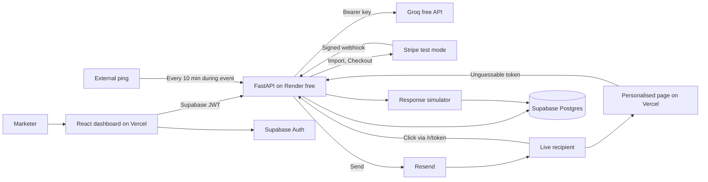

# Win-back Agent: System Design

Theme: Marketing Reimagined. Build window: 12 hours. Team: 4.

"Win-back Agent" is a working name.

## Decisions from the interview

| Decision | Choice | Alternative rejected | Trade-off accepted |
|---|---|---|---|
| Core job | Win back cancelled subscribers by email | Landing page optimiser, ad fixer, reputation responder | Less novel, but it can prove revenue live |
| Customer and data | SaaS subscribers via Stripe test mode | Shopify, HubSpot, CSV | Less behavioural data, so churn comments drive personalisation |
| Autonomy | Agent proposes, human approves once per campaign | Guardrailed full autonomy | Weaker "autonomous" claim, stronger trust story |
| Proof | Live loop plus clearly labelled simulation | Real-only, simulation-only | Must build a simulator, and judges may discount that part |
| Live recipients | Pre-seeded team inboxes | QR opt-in | No audience participation, but predictable and no consent problem |
| Innovation feature | Personalised win-back pages | Synthetic panel, churn roadmap, voice | Closer to content generation than decision-making |
| After results | One round plus a written recommendation | Two rounds, bandit | The agent does not learn, and the pitch must not claim it does |
| Budget | Totally free, including LLM calls | About $5 of LLM credits | Free-tier limits shape the design, especially LLM tokens |
| LLM | Groq free API | Ollama Cloud (pay per token), Ollama on a laptop | Replaces Ollama, and rate limits restrict practice runs |
| Email | Resend + Student Pack domain | Paid domain | Depends on student eligibility, so it needs a fallback |
| Hosting | Vercel + Render free | Railway, Vercel only, tunnel | Cold starts, so a keep-awake ping is needed |
| Access | One workspace, one login | Multi-tenant, no login | Not a real SaaS yet |
| Demo backup | Screen recording only | Saved run replay | Failure means an abrupt switch to video |

## 1. Problem statement

When a SaaS subscriber cancels, the reason usually sits unread in a billing system. Win-back efforts tend to be one generic discount sent to everyone, because analysing reasons and tailoring offers takes marketer time that small teams don't have. That gives away margin to people who would have paid more, and offers nothing relevant to people who left over a missing feature.

The Win-back Agent reads cancellation data, works out why customers left, and proposes a campaign tailored to each reason. After a marketer approves with one click, it sends the emails, serves each cohort a personalised page, and measures revenue attributed through Stripe. It then writes a recommendation for what to do next.

**Pitch line:** "The agent does the analysis and strategy. A marketer spends 30 seconds on one decision, and every recovered dollar is traced back to the decision that earned it."

## 2. Functional requirements

**Must have**

| ID | Requirement |
|---|---|
| F1 | Import cancelled subscribers from Stripe test mode, including cancellation reason and comment |
| F2 | Group customers into churn-reason cohorts using the LLM, with revenue at stake per cohort |
| F3 | Choose an offer from a fixed catalog and write two message variants per cohort, with stated reasoning |
| F4 | Enforce discount, send-cap and exposure limits in code |
| F5 | Show a single approval screen per campaign: cohorts, reasoning, offers, and maximum discount exposure |
| F6 | Send real email only to allow-listed live recipients via Resend |
| F7 | Track clicks through a backend redirect link |
| F8 | Generate a personalised page per cohort and variant, rendered in a fixed React template |
| F9 | Complete a Stripe test checkout with the correct discount, confirmed by webhook |
| F10 | Attribute each conversion to recipient, variant, cohort and campaign |
| F11 | Simulate responses for seeded customers from independent hidden rates |
| F12 | Show live and simulated results separately on the dashboard |
| F13 | Produce a written recommendation based on measured results, which is not executed automatically |
| F14 | Protect the dashboard and its actions with one login |
| F15 | Include a working unsubscribe link in every email |

**Stretch, only after the feature freeze criteria are met:** execute the recommendation as a second round.

**Out of scope:** multi-tenancy, Stripe Connect, QR sign-up, open tracking, automatic learning, any live-mode payments, and statistical significance claims.

## 3. Non-functional requirements

| Area | Target |
|---|---|
| Agent run latency | Under 5 minutes for about 200 customers, paced by Groq's per-minute token limit |
| Click redirect | Under 300 ms once the backend is awake |
| Dashboard freshness | Polling every 2-3 seconds, so a conversion appears within about 5 seconds of the webhook |
| Scale | About 200 simulated and 3-5 live recipients. No further scaling work in the MVP |
| Reliability | Agent progress saved after each step, so a restart can resume a run |
| Cost | $0 in total. No service may require paid usage |
| LLM usage | About 30k tokens per full run (see section 9) |
| Security | No secrets in the browser, verified webhooks, test-mode keys only |
| Honesty | Simulated data is labelled wherever shown, and never added to live figures |

## 4. High-level system architecture



**The loop:**

1. **Import.** Pull cancelled subscribers from Stripe into Supabase.
2. **Diagnose.** The LLM groups cancellation comments into cohorts.
3. **Propose.** For each cohort, the LLM picks an offer from the catalog, writes two variants, and generates page content. Code validates it all.
4. **Approve.** The marketer approves the campaign with one click.
5. **Act.** Live recipients get real email and simulated recipients get simulated responses.
6. **Measure.** Click, page, checkout and webhook events are attributed.
7. **Recommend.** Code computes the metrics and the LLM writes the next-step recommendation from them.

**The core design rule: the LLM decides within limits, and code owns the facts.** Prices, discount amounts, recipient lists and metrics never come from model output.

## 5. Component breakdown

| Component | Owner | Responsibility |
|---|---|---|
| Dashboard (React) | Design/front-end/pitch lead | Login, run progress, approval, results, recommendation |
| Agent orchestrator | Backend 1 | Step-by-step run saved to Supabase, resumable |
| LLM client | Backend 1 | Groq calls with strict JSON schemas, pacing and 429 handling, one retry then fallback, saved responses for development, token logging |
| Diagnose step | Backend 1 | Discovers cohort labels from a sample, then assigns each distinct comment once, in batches |
| Strategy step | Backend 1 | Picks offers and variants per cohort, with reasoning |
| Guardrails | Backend 1 | Rejects any offer outside the catalog and enforces limits |
| Simulator | Backend 1 | Hidden rates per cohort and offer, fixed random seed, compressed timing |
| Report step | Backend 1 | Computes metrics in code, LLM writes the recommendation |
| Stripe integration | Backend 2 | Seed script, import, coupons, Checkout, webhook |
| Email integration | Backend 2 | Resend send, recipient allow-list, unsubscribe, sender behind one interface for fallback |
| Tracking | Backend 2 | `/r/{token}` redirect and event recording |
| Auth and deployment | Backend 2 | JWT verification, Render, environment variables, keep-awake ping |
| Page generator | Innovation teammate | LLM produces `PageContent` per cohort and variant |
| Page template | Innovation teammate, with front-end lead | Public React route rendering `PageContent` |

**Fallbacks:**

- **Cohort assignment:** if the LLM fails, use Stripe's `cancellation_details.feedback` value (for example `too_expensive`, `missing_features`, `switched_service`) as the cohort.
- **Strategy:** if output is invalid after one retry, use a default offer for that cohort and mark it visibly as a fallback.
- **Page:** if generation fails, use cohort-level default copy in the same template.

**`PageContent` contract, to be agreed in hour 1:**

```json
{
  "headline": "string",
  "subheadline": "string",
  "reasons": [{ "title": "string", "body": "string" }],
  "objection_response": "string",
  "cta_label": "string"
}
```

The offer text and price are added by code from the catalog. The template renders all values as plain text, never as HTML.

## 6. Database schema

All tables have row-level security enabled with no public policies. Only the backend can access them, using the service key.

```sql
create table customers (
  id uuid primary key default gen_random_uuid(),
  stripe_customer_id text unique not null,
  email text not null,
  name text,
  plan text,
  mrr_cents int not null default 0,
  churned_at timestamptz,          -- from seeded metadata; see risk R6
  cancel_feedback text,
  cancel_comment text,
  is_simulated boolean not null default true,
  unsubscribed_at timestamptz
);

create table offers (
  id uuid primary key default gen_random_uuid(),
  label text not null,
  percent_off int not null check (percent_off between 0 and 50),
  duration_months int not null,
  stripe_coupon_id text,
  active boolean not null default true
);

create table agent_runs (
  id uuid primary key default gen_random_uuid(),
  status text not null,            -- running, awaiting_approval, failed, complete
  current_step text,
  limits jsonb not null,           -- max percent, send cap, max exposure
  error text,
  started_at timestamptz not null default now(),
  finished_at timestamptz
);

create table cohorts (
  id uuid primary key default gen_random_uuid(),
  run_id uuid not null references agent_runs(id),
  label text not null,
  summary text,
  customer_count int not null default 0,
  mrr_at_stake_cents int not null default 0
);

create table cohort_members (
  cohort_id uuid references cohorts(id),
  customer_id uuid references customers(id),
  confidence numeric,
  assigned_by text not null,       -- llm or fallback
  primary key (cohort_id, customer_id)
);

create table campaigns (
  id uuid primary key default gen_random_uuid(),
  run_id uuid not null unique references agent_runs(id),
  status text not null,            -- draft, approved, rejected, sending, sent
  max_exposure_cents int,
  approved_by uuid,
  approved_at timestamptz
);

create table variants (
  id uuid primary key default gen_random_uuid(),
  campaign_id uuid not null references campaigns(id),
  cohort_id uuid not null references cohorts(id),
  label text not null,             -- A or B
  offer_id uuid not null references offers(id),
  subject text not null,
  body_text text not null,
  page_content jsonb not null,
  reasoning text not null,
  is_fallback boolean not null default false
);

create table recipients (
  id uuid primary key default gen_random_uuid(),
  campaign_id uuid not null references campaigns(id),
  customer_id uuid not null references customers(id),
  variant_id uuid not null references variants(id),
  token text unique not null,      -- at least 128 random bits
  source text not null,            -- live or simulated
  resend_message_id text,
  sent_at timestamptz,
  unique (campaign_id, customer_id)
);

create table events (
  id bigint generated always as identity primary key,
  recipient_id uuid not null references recipients(id),
  type text not null,              -- sent, delivered, clicked, page_viewed, checkout_started, unsubscribed
  source text not null,            -- live or simulated
  occurred_at timestamptz not null default now()
);

create table conversions (
  id uuid primary key default gen_random_uuid(),
  recipient_id uuid not null unique references recipients(id),
  stripe_session_id text unique,   -- null for simulated
  mrr_cents int not null,
  source text not null,
  occurred_at timestamptz not null default now()
);

create table processed_webhooks (
  provider text not null,
  event_id text not null,
  received_at timestamptz not null default now(),
  primary key (provider, event_id)
);

create table reports (
  id uuid primary key default gen_random_uuid(),
  campaign_id uuid not null unique references campaigns(id),
  metrics jsonb not null,
  recommendation text not null,
  created_at timestamptz not null default now()
);

create table llm_calls (
  id bigint generated always as identity primary key,
  run_id uuid references agent_runs(id),
  step text not null,
  model text not null,
  input_tokens int,
  output_tokens int,
  latency_ms int,
  ok boolean not null,
  created_at timestamptz not null default now()
);
```

## 7. API design

**Authenticated with a Supabase JWT**

| Method and path | Purpose |
|---|---|
| `POST /api/runs` | Import from Stripe and start a run with its limits |
| `GET /api/runs/{id}` | Status, current step, cohorts |
| `POST /api/runs/{id}/resume` | Continue from the last saved step |
| `GET /api/campaigns/{id}` | The approval view |
| `POST /api/campaigns/{id}/approve` | Approve and start sending. Repeating it has no further effect |
| `POST /api/campaigns/{id}/reject` | Reject the proposal |
| `GET /api/campaigns/{id}/results` | Live and simulated metrics, returned as separate objects |
| `POST /api/campaigns/{id}/report` | Generate the recommendation |
| `GET /api/usage` | LLM tokens used, per run and for the day |

**Public, identified by unguessable token**

| Method and path | Purpose |
|---|---|
| `GET /r/{token}` | Record the click and redirect to the page |
| `GET /api/pages/{token}` | Page content and offer details, with no other customer data |
| `POST /api/pages/{token}/checkout` | Create a Stripe Checkout Session using the recipient's assigned offer |
| `GET /u/{token}` | Unsubscribe |

**Webhooks and health**

| Method and path | Purpose |
|---|---|
| `POST /webhooks/stripe` | Verify the signature, ignore duplicates, record `checkout.session.completed` as a conversion |
| `POST /webhooks/resend` | Optional: delivery and bounce events, with signature verified |
| `GET /health` | Used by the keep-awake ping and pre-demo check |

## 8. Technology stack with justification

| Layer | Choice | Why |
|---|---|---|
| Front end | React, Vite, TypeScript | Team's choice. Vite deploys to Vercel as a static app |
| Backend | Python, FastAPI, Pydantic, `httpx` | Team's choice. Pydantic validates all LLM output |
| Background work | FastAPI `BackgroundTasks` with state in Postgres | No queue to run, and saved state covers restarts |
| Database and auth | Supabase Postgres and Auth | Team's choice. One service covers both |
| Live updates | Polling | Simpler than realtime subscriptions and adequate at this scale |
| LLM | Groq free API, called without streaming | Free, fast, no hardware to manage |
| Model | Start with `openai/gpt-oss-20b`, and compare `openai/gpt-oss-120b` and `qwen/qwen3.8-27b` in hour 1 | All three support strict JSON schema output. Choose on writing quality and speed |

## 9. External services and integrations

| Service | Use | Cost | Notes |
|---|---|---|---|
| Stripe (test mode) | Customers, cancellations, coupons, Checkout, webhooks | $0 | Backend refuses to start unless the key begins `sk_test_` |
| Resend | Sending real email | $0, within 100 per day and 3,000 per month | Needs a verified domain |
| Groq | All LLM calls | $0 | Check the Free Plan tab for your account's limits; see the budget below |
| Supabase | Database and auth | $0 | Free tier |
| Vercel | Front end | $0 | Hobby plan is for non-commercial use |
| Render | Backend | $0 | Sleeps after 15 minutes idle; about a minute to wake |
| Uptime pinger | Keep-awake requests | $0 | During the event only |
| GitHub | Source and deploy trigger | $0 | Not used for hosting |

**Email domain fallback, decided by the end of hour 1:**

1. GitHub Student Pack domain, if a teammate qualifies and it verifies in time.
2. Otherwise, a DigitalPlat `dpdns.org` domain, time-boxed to 30 minutes and tested with a real send to a Gmail inbox.
3. Otherwise, Gmail SMTP with an app password, behind the same sender interface.

The Student Pack domain is free for the first year only, so turn off auto-renewal.

**LLM token budget:** Groq's docs list `openai/gpt-oss-20b` at 30 requests per minute, 8K tokens per minute, 1K requests per day and 200K tokens per day. Those figures are for its Developer plan, so confirm the real free limits on your account's limits page in hour 1 and adjust this budget.

| Step | Estimated tokens | How it stays small |
|---|---|---|
| Discover cohorts | 2k | Uses a sample of comments |
| Assign cohorts | 8k | Classifies each distinct comment once. Seed about 50 distinct comments across the 200 customers |
| Strategy and page content | 15k | One call per cohort, for about 5 cohorts, with no per-recipient generation |
| Recommendation | 2k | Receives computed metrics, not raw events |
| **Full run** | **About 30k, with margin** | |

**What these limits mean, if the listed figures apply:**

- **Run time:** 30k tokens at 8K per minute takes about 4 minutes, so the client paces requests and waits when it gets a 429 response.
- **Practice runs:** 200K per day allows about 6 full runs, shared by the whole team.
- **Development:** set `LLM_MODE=saved` to replay saved responses during normal development. Only make real calls when testing prompts.
- **Demo day:** keep at least 60K tokens untouched for 2 full runs, and stop real practice runs once you reach that reserve.

**Cost vs value:** the dashboard shows tokens used and $0 LLM cost next to attributed live revenue, using `llm_calls`. Be clear that $0 reflects the free tier. Real customer volumes would need a paid plan, so quote the measured tokens per run if judges ask about costs at scale.

## 10. Deployment architecture

- **Repository:** one repo with `frontend/`, `backend/` and `supabase/migrations/`.
- **Front end:** Vercel, deployed from `main`, with a rewrite so `/w/{token}` reaches the single-page app.
- **Backend:** one Render free web service, deployed from `main`.
- **Environment:** `main` is the only environment. Secrets are stored in the Render and Vercel settings.
- **Keep-awake:** ping `/health` every 10 minutes during the event, then manually load it about 5 minutes before the demo.

| Secret | Location |
|---|---|
| `STRIPE_SECRET_KEY`, `STRIPE_WEBHOOK_SECRET` | Render |
| `RESEND_API_KEY`, `RECIPIENT_ALLOWLIST` | Render |
| `GROQ_API_KEY`, `GROQ_MODEL`, `LLM_MODE` | Render |
| `SUPABASE_URL`, `SUPABASE_SERVICE_KEY`, JWT verification settings | Render |
| `VITE_SUPABASE_URL`, `VITE_SUPABASE_ANON_KEY`, `VITE_API_URL` | Vercel (these are safe to expose) |

## 11. Security considerations

| Threat | Control |
|---|---|
| Unauthorised sending | Approval requires a valid JWT, and approving twice has no further effect |
| Email to the wrong people | `RECIPIENT_ALLOWLIST` is checked immediately before every send, and simulated recipients have no send path |
| Forged purchases | Stripe signature verification and duplicate-event protection |
| Excessive discounts | Offers come only from the catalog, and the database limits them to 50% |
| Price tampering | Checkout uses the offer stored against the token and ignores browser-supplied values |
| Prompt injection through cancellation comments | Comments are treated as data, output must match a schema, and the model has no tools |
| Script injection on pages | Fixed template, plain text rendering, no raw HTML |
| Token guessing | At least 128 random bits, with pages exposing only what the recipient needs |
| Exposed secrets | Service, Stripe and Resend keys stay on the backend |
| Direct data access | Row-level security on with no public policies |
| Real payments | Test keys only, enforced at startup |
| Personal data | Seeded data is fictional on `example.com`. Team inboxes are used by agreement. Cancellation comments go to Groq, so real customer data would need a review of its terms first |
| Open CORS | Allow only the Vercel domain |

**Known MVP limitation:** public token endpoints have no rate limiting. That's acceptable for a demo but must be added before any real use.

## 12. Potential bottlenecks and risks

| ID | Risk | Likelihood | Impact | Mitigation |
|---|---|---|---|---|
| R1 | A live agent run is too slow to watch on stage | High | High | Start the run before going on stage and open the demo at the approval screen |
| R2 | Render is asleep, or restarts mid-run | Medium | High | Ping, manual warm-up, resumable steps. Stripe retries webhooks, though possibly too late for the demo |
| R3 | Model returns invalid or weak output | Low | Medium | Strict JSON schemas, Pydantic validation, one retry, fallbacks |
| R4 | Groq's per-minute limit slows a run or returns 429 errors | High | Medium | Pace requests, honour retry timing, keep prompts small, and start runs before the demo |
| R5 | Domain verification is late, or email lands in spam | Medium | High | Start in hour 1, use the fallback chain, send a test early |
| R6 | Stripe timestamps show every cancellation as today | Certain | Low | Store a seeded `churned_at` in Stripe metadata and use that |
| R7 | Seeded customers need payment details before subscribing | Medium | Low | Use Stripe's test payment method in the seed script, and run it once |
| R8 | Email security scanners follow links and create false clicks | Low | Low | Revenue comes from the webhook, not clicks |
| R9 | Judges distrust simulated figures | Medium | Medium | Label them, explain the hidden rates, and lead with the live purchase |
| R10 | The personalised pages feel disconnected from the agent | Medium | Medium | Page content comes from the same strategy step, using the cohort's actual reasons |
| R11 | Screen recording is the only backup, so a mid-demo switch is abrupt | Medium | Medium | Rehearse the switch, and have the video open in a tab |
| R12 | The pitch overclaims | Medium | High | Say "proposes and measures." Don't say "fully autonomous" or "learns" |
| R13 | The team uses up Groq's daily tokens before the demo | Medium | High | Saved responses in development, a token counter on the dashboard, a 60K reserve, and finishing the demo run early. Fall back to the template recommendation and the recording |
| R14 | Small live samples are read as proof of lift | High | Medium | Show raw counts, and don't claim significance |

## 13. MVP implementation roadmap

| Hours | Front end and pitch | Backend 1 (agent) | Backend 2 (integrations) | Innovation |
|---|---|---|---|---|
| **0-1** | Agree API contract, wireframes | Groq key, confirm free limits, model test, saved-response mode | Accounts, domain, deploy hello-world to Vercel and Render | Agree `PageContent` contract |
| **1-4** | Dashboard on mock data, login | Schema, orchestrator, diagnose step | Stripe seed, import, coupons | Page template with sample data |
| **4-7** | Approval screen on the real API | Strategy step, guardrails | Send, redirect, Checkout, webhook | Page generation in the strategy step |
| **Hour 7 checkpoint** | **On deployed URLs: run, approve, receive email, click, open page, pay, see the conversion** | | | |
| **7-9** | Results view with live/simulated split | Simulator, report step | Unsubscribe, allow-list, security checks | Polish pages for each cohort |
| **9-10** | Feature freeze, UI polish | Fix failures, cost tracking | Harden webhooks, set up the ping | Test weak cohorts and fallbacks |
| **10-11** | Record backup video, write pitch | Rehearsal support | Rehearsal support | Rehearsal support |
| **11-12** | Rehearse twice, buffer | Bug fixes only | Bug fixes only | Bug fixes only |

**If you're behind at the hour 7 checkpoint, cut in this order:**

1. Resend delivery webhooks
2. Second message variant per cohort, keeping one offer per cohort
3. Polish in the simulator, keeping basic hidden rates
4. LLM-written recommendation, replaced by a template driven by computed metrics

**Never cut:** the live loop from approval to attributed Stripe conversion, the guardrails, or the labels on simulated data.

**Stretch, only if everything above is finished by hour 9:** execute the recommendation as a second round.

### Demo script

1. **Before going on stage:** warm the backend, check Groq tokens remaining, and start the run at least 10 minutes ahead so it's waiting at the approval screen.
2. **The problem:** show the cancelled revenue and cohorts the agent found.
3. **The decision:** show the reasoning and maximum discount exposure, then click Approve.
4. **The action:** open the real email in a team inbox on the projector, then click through.
5. **The innovation:** show a personalised page, and compare it briefly with a page for another cohort.
6. **The proof:** pay with test card `4242 4242 4242 4242`, and watch the live revenue update.
7. **The scale:** show the labelled simulated results.
8. **The next step:** show the recommendation, then the $0 LLM cost and tokens used next to the revenue recovered.

**If something breaks:** switch to the screen recording and say so.

### How this maps to the judging criteria

| Criterion | Points | How the design earns them |
|---|---|---|
| Problem solving | 25 | Addresses a specific revenue problem with attributed recovery |
| AI-driven innovation | 25 | LLM diagnoses reasons, chooses strategy, and personalises pages. **This is the weakest area**, because learning was cut |
| Third-party integrations | 15 | Stripe, Resend, Groq, Supabase, all doing necessary work |
| Product experience and demo | 10 | Real email, real page, real test checkout on stage |
| Cost vs value bonus | 10 | Built and run for $0, with measured tokens per run next to revenue |

### Open items to check

- **Judging points:** the listed criteria total 85 (75 plus the 10 bonus), not 100. Check the brief for a missing 25-point criterion, as it could change priorities.
- **Is Ollama required?** The original plan named Ollama. If the hackathon or a sponsor requires it, this design needs revisiting.
- **Groq limits:** confirm the Free Plan tab on your account's limits page, and when the daily allowance resets, before relying on the token budget.
- **Free sign-ups:** confirm no service asks for a card you'd rather not provide, especially the Student Pack domain.
- **Resend:** test sending to an address other than the account owner's once the domain is verified.
- **Student Pack:** confirm the current offer and whether anyone on the team qualifies.

### Sources

- [Groq rate limits](https://console.groq.com/docs/rate-limits)
- [Groq structured outputs](https://console.groq.com/docs/structured-outputs)
- [Ollama pricing, the reason Ollama Cloud was dropped](https://ollama.com/pricing)
- [Resend usage limits](https://resend.com/docs/api-reference/rate-limit)
- [Resend pricing](https://resend.com/pricing)
- [Resend Stripe Projects guide](https://resend.com/docs/guides/stripe-projects-integration)
- [Render free tier](https://render.com/docs/free)
- [Name.com Student Pack article](https://www.name.com/de-de/support/articles/360036364834-signing-up-for-github-student-developer-pack)
- [Vercel forum thread on dpdns.org](https://community.vercel.com/t/unable-to-add-dpdns-org-second-level-domain-resolution/7161)
